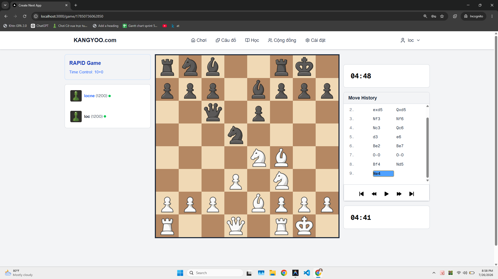
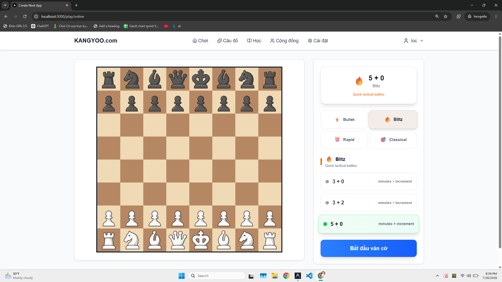
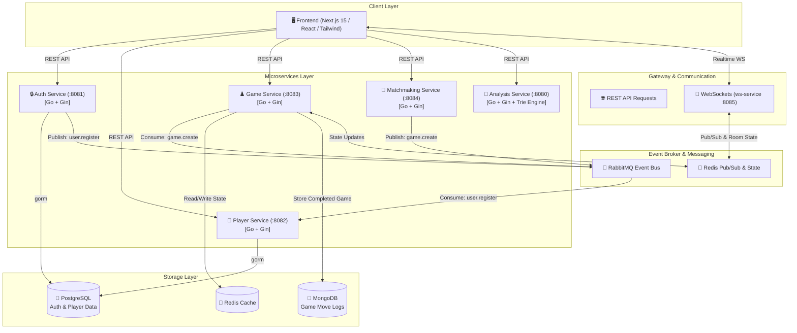

# ♟️ Distributed Realtime Chess Platform - Microservices Architecture

[](https://go.dev/)
[](https://nextjs.org/)
[](https://www.docker.com/)
[](https://www.rabbitmq.com/)
[](https://redis.io/)
[](https://www.postgresql.org/)
[](https://www.mongodb.com/)

A high-performance, distributed microservices platform for playing, matching, and analyzing chess games in real time with ultra-low latency. Built with **Go**, **Event-Driven Architecture (RabbitMQ)**, **Redis Pub/Sub**, **Polyglot Persistence**, and **Next.js 15**.

---

## 🌟 Key Features & Highlights

### ⚡ Ultra-Low Latency Realtime Gameplay
- **Dedicated WebSocket Service (`ws-service`)**: Decoupled connection gateway handling persistent client WebSockets for move broadcasts and room state updates with millisecond-level responsiveness.
- **In-Memory Game State Management**: High-speed game state read/writes backed by Redis during active gameplay.
- **Sub-Millisecond Clock & State Sync**: Optimized time-control countdowns and instant move distribution over Redis Pub/Sub channels to prevent latency lag during fast Bullet/Blitz games.

### 🎮 Automated Matchmaking Queue
- **Concurrent Worker Pool (`matchmaking-service`)**: Asynchronous matchmaking service with a dynamic worker pool that groups players based on availability and rating.
- **Asynchronous Game Provisioning**: Publishes `game.create` events over RabbitMQ to provision games without blocking the HTTP request pipeline.

### 📖 Chess Opening & Position Analysis
- **Trie-based Opening Book Engine (`analysis-service`)**: High-performance prefix tree algorithm (`OpeningTrie`) for instant opening detection, move suggestions, and transposition lookup.

### 🔄 Asynchronous Event-Driven Decoupling
- **User Registration Flow**: `auth-service` emits `user.register` events to RabbitMQ, consumed asynchronously by `player-service` to initialize player statistics and Elo ratings.
- **Polyglot Persistence**:
  - **PostgreSQL**: Relational storage for user credentials, authentication, and player profile stats.
  - **MongoDB**: Document storage for detailed game move logs, PGNs, and match histories.
  - **Redis**: Fast cache, active session management, and Pub/Sub channel distribution.

---

## 📸 Application Screenshots

| ♟️ Realtime Gameplay & Board | 🎯 Matchmaking & Time Control Selector |
| :---: | :---: |
|  |  |

---

## 🏗️ System Architecture



---

## 🛠️ Tech Stack & Service Breakdown

### Frontend
- **Framework**: Next.js 15 (App Router), React 19, TypeScript
- **Styling**: Tailwind CSS
- **Features**: Interactive Chess Board, Realtime WebSockets, Replay Controls, Opening Explorer

### Microservices (Backend)
| Service Name | Tech / Framework | Database / Broker | Primary Function | Port |
| :--- | :--- | :--- | :--- | :--- |
| **`auth-service`** | Go (Gin, GORM) | PostgreSQL, RabbitMQ | User Authentication, JWT Tokens, Emit `user.register` | `8081` |
| **`player-service`** | Go (Gin, GORM) | PostgreSQL, RabbitMQ | Player Profile Management, Elo Stats, Consume `user.register` | `8082` |
| **`game-service`** | Go (Gin) | MongoDB, Redis, RabbitMQ | Game Logic, State Sync, Consume `game.create`, Log Matches | `8083` |
| **`matchmaking-service`** | Go (Gin) | RabbitMQ | Worker Pool Queueing, Match Formation, Emit `game.create` | `8084` |
| **`ws-service`** | Go (Gin, Gorilla WS) | Redis Pub/Sub | Realtime WebSocket Gateway, Move & State Broadcasts | `8085` |
| **`analysis-service`** | Go (Gin) | Custom In-Memory Trie | Opening Book Lookup, Move Suggestions via Trie Data Structure | `8080` |

### Infrastructure
- **PostgreSQL 15**: Relational Database for Auth & Player profiles
- **MongoDB 6.0**: Document Database for Game Match histories & moves
- **Redis 7.0**: High-speed cache, match sessions, and Pub/Sub channel messaging
- **RabbitMQ 3.0**: AMQP Event Broker with Management UI (`:15672`)
- **Docker Compose**: Container Orchestration with health-checks and automatic retry loops

---

## 🚀 Quick Start (Local Setup with Docker)

### Prerequisites
- [Docker Desktop](https://www.docker.com/products/docker-desktop/) (with Docker Compose enabled)
- Git

### 1️⃣ Clone the Repository
```bash
git clone https://github.com/loc-ne/chess-platform-backend.git
cd chess-platform-backend
```

### 2️⃣ Launch All Microservices & Databases
Run a single command to build and launch all 11 containers (4 databases/queues + 6 microservices + 1 frontend):

```bash
docker compose up -d
```

### 3️⃣ Access Services
Once containers are running and healthy:

- 🎮 **Frontend Application**: [http://localhost:3000](http://localhost:3000)
- 🐇 **RabbitMQ Management Dashboard**: [http://localhost:15672](http://localhost:15672) *(Credentials: `guest` / `guest`)*
- 🐘 **PostgreSQL Port**: `5432` *(User/Pass: `postgres` / `postgres`, DB: `chess_db`)*
- 🍃 **MongoDB Port**: `27017` *(DB: `kangyoo`)*
- 🔴 **Redis Port**: `6379`

---

## 📁 Project Structure

```text
chess-platform-backend/
├── analysis-service/       # Opening book analysis engine (Trie algorithm)
├── auth-service/           # User authentication & JWT session management
├── frontend/               # Next.js 15 web app (React 19, TypeScript, Tailwind CSS)
├── game-service/           # Realtime game state, move validation & persistence
├── matchmaking-service/    # Asynchronous player matchmaking queue & worker pool
├── player-service/         # Player profiles, ratings & stats management
├── ws-service/             # Realtime WebSocket gateway & Redis Pub/Sub listener
├── docs/                   # System architecture diagrams & screenshots
└── docker-compose.yml      # Orchestration for all 11 microservices & databases
```

---

## 💡 Engineering & Architecture Design Highlights

1. **Non-Blocking Asynchronous Operations**: Heavy/long-running operations (such as initializing a new game or provisioning player stats) are delegated to RabbitMQ queues, ensuring HTTP response endpoints return within milliseconds.
2. **Resilient Connection Handling**: Custom connection retry logic (`ConnectRabbit()`) and `restart: unless-stopped` policies ensure containers gracefully handle database or broker initialization timing without crashing.
3. **Optimized Opening Lookup**: Uses an in-memory prefix Trie algorithm (`OpeningTrie`) in `analysis-service` for $O(K)$ time complexity search over opening move sequences.
